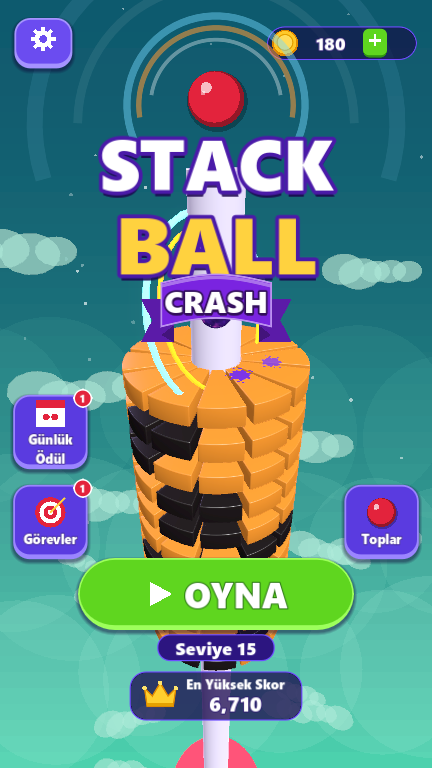
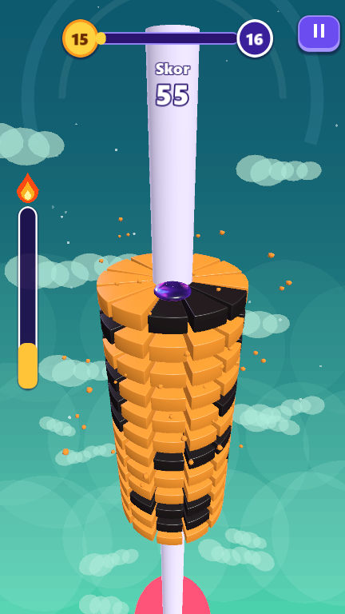
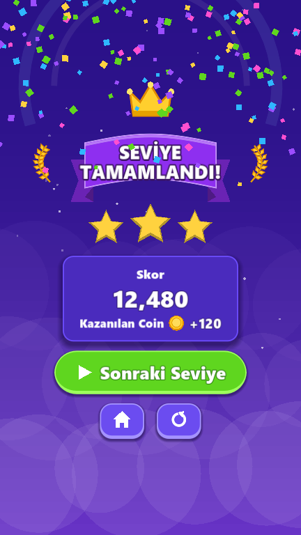
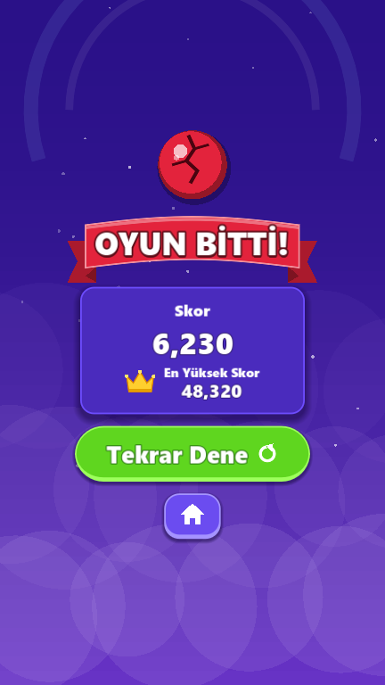
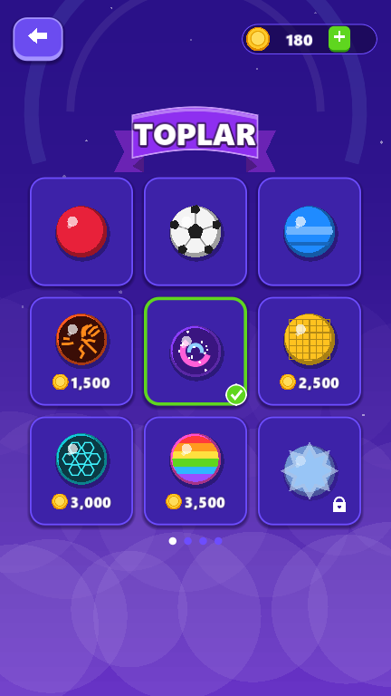
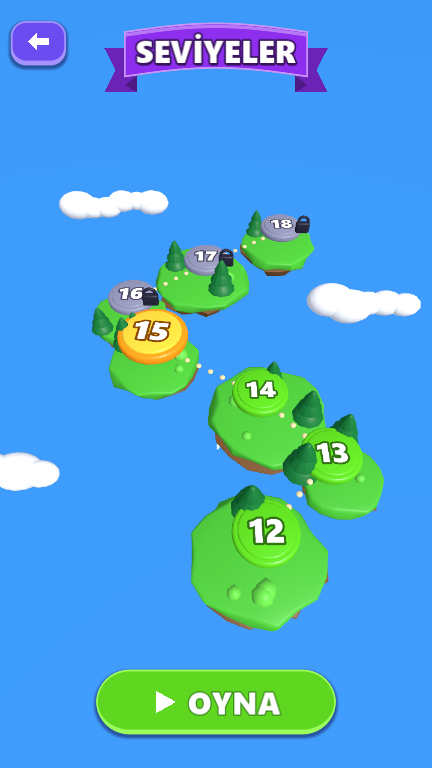
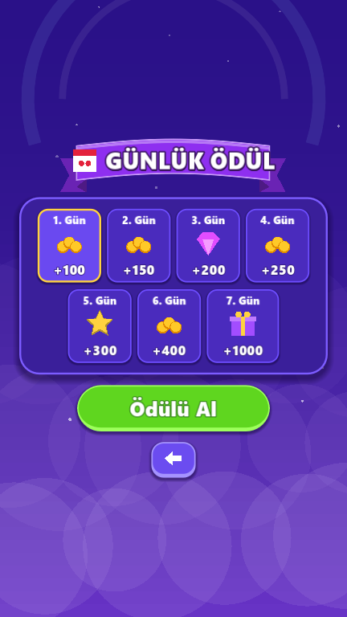
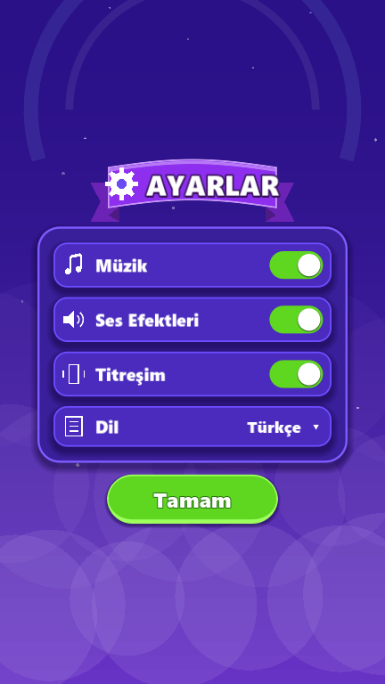

# 🎯 Stack Ball Crash

**Godot 4 ile yapılmış 3D hyper-casual mobil oyun.** Topu dönen kulenin içinden aşağı indir, renkli platformları parçala, siyahlardan kaçın, kombo yap ve ateş topuna dönüş!


<p align="center">
  
  
  
  
</p>
<p align="center">
  
  
  
  
</p>

---

## 🎮 Nasıl Oynanır

| Kontrol | Etki |
|---------|------|
| **Ekrana basılı tut** (mobil) / **Sol fare tuşu** (masaüstü) | Top hızla aşağı iner ve renkli platformları kırar |
| **Bırak** | Top güvenli platformda zıplar |

- 🟨 **Renkli bloklar** basılı tutarak kırılır.
- ⬛ **Siyah bloklar** tehlikelidir — kırmaya çalışırsan oyun biter.
- 🕳️ **Boşluklardan** top serbestçe aşağı düşer.
- 🔥 Art arda platform kırarak **kombo** yap; gösterge dolunca top kısa süreliğine **ateş topuna** dönüşür ve siyah blokları da kırar.
- 🏁 Kulenin dibine ulaşınca seviye tamamlanır.

## ✨ Özellikler

- **Prosedürel seviyeler** — 30 seviyelik zorluk eğrisi, sonrasında sonsuz ve kontrollü zorluk artışı (halka sayısı, siyah oranı, boşluk genişliği, dönüş hızı, renk paleti). Her halkada geçilebilir güvenli alan garanti edilir.
- **Tünellemesiz çarpışma** — fizik motoruna güvenmek yerine topun önceki/yeni yüksekliği arasındaki tüm halka düzlemleri sırayla kontrol edilir; kule dönüş açısı hesaba katılır, her halka yalnızca bir kez işlenir.
- **Tatmin edici efektler** — savrulan kırık parçalar, kıvılcımlar, zıplama lekeleri, squash & stretch, kamera sarsıntısı, alev izi.
- **Tam arayüz** — Ana menü, HUD, Seviye Tamamlandı (konfeti), Oyun Bitti, Duraklatma, Top Koleksiyonu, 3D Seviye Haritası, Günlük Ödül, Görevler, Ayarlar.
- **9 top görünümü** — kırmızı, futbol, mavi, lav, galaksi, altın, neon, gökkuşağı, kristal (desen + parlama dokuları).
- **Coin ekonomisi** — seviye ödülleri, günlük ödül takvimi, görev ödülleri, top satın alma.
- **Yerel kayıt** — `user://save.cfg` (ConfigFile). Kayıt yoksa otomatik oluşturulur, bozuk dosyada oyun çökmez.
- **Ses sistemi** — `assets/audio/` içine dosya konmazsa sesler prosedürel üretilir; dosya eklenirse otomatik kullanılır.
- **Titreşim** — Android / iOS'ta isteğe bağlı.
- **Mobil optimizasyon** — her halka tek mesh'te birleştirilir (düşük draw call), görünürlük mesafesi, kısa ömürlü ve otomatik temizlenen efektler, Mobile renderer + OpenGL fallback.
- **Harici bağımlılık yok** — eklenti yok; modeller Blender'da üretildi, dokular ve sprite'lar Python ile üretildi, arayüz ikonları kodla çiziliyor.

## 🚀 Çalıştırma

1. [Godot 4.7+](https://godotengine.org/download) indir.
2. Repoyu klonla:
   ```bash
   git clone https://github.com/Mehmetcengiz16/stack-ball-crash.git
   ```
3. Godot'da **Import** → `project.godot` dosyasını seç → **F5** ile çalıştır.

### Android export
`export_presets.cfg` içinde Android ayarı hazır (`com.jumpi.stackballcrash`, arm64 + armv7, titreşim izni). Godot'da Android SDK ve export şablonlarını kurduktan sonra **Project → Export → Android**.

## 🗂️ Proje Yapısı

```
├── project.godot
├── scenes/                 # main, player, tower, platform_segment + ui/*.tscn
├── scripts/
│   ├── game_manager.gd     # Merkezi durum, skor, coin (autoload)
│   ├── save_manager.gd     # Yerel kayıt (autoload)
│   ├── audio_manager.gd    # Ses + titreşim (autoload)
│   ├── main.gd             # Sahne kurulumu, olay bağlantıları
│   ├── player_controller.gd# Top fiziği, swept çarpışma, kombo/ateş topu
│   ├── tower_controller.gd # Kule, halkalar, kırılma efektleri
│   ├── level_generator.gd  # Prosedürel seviye üretimi
│   ├── platform_segment.gd # Dilim geometrisi (SurfaceTool)
│   ├── camera_controller.gd
│   ├── decor.gd            # Bulutlar ve menü halkası
│   ├── ball_skins.gd       # Top görünümleri
│   ├── ui_manager.gd
│   └── ui/                 # Tüm ekranlar + UIKit (stil, ikon, kurdele çizimi)
├── assets/
│   ├── models/             # Blender .glb modelleri
│   ├── textures/           # Top dokuları ve efekt sprite'ları
│   └── audio/              # (isteğe bağlı) ses dosyaları
├── tools/                  # Doku/sprite üretim scriptleri (Python)
└── tests/                  # Headless oynanış testi + ekran görüntüsü araçları
```

## 🧪 Testler

Headless oynanış testi (zıplama, kırma, bitirme, siyahta ölme, sahne temizliği, bozuk kayıt):

```bash
godot --headless --path . res://tests/test_gameplay.tscn
```

## ⚙️ Ayarlanabilir Parametreler

`scripts/player_controller.gd` içinde Inspector'dan değiştirilebilir:
`gravity`, `bounce_velocity`, `smash_speed`, `combo_threshold`, `fireball_duration`, `fireball_speed_mult`…

## 🎨 Varlıkları Yeniden Üretmek

```bash
python tools/gen_ball_textures.py   # top dokuları
python tools/gen_fx_sprites.py      # leke, alev, kıvılcım
```

---

Bu oyun, türün temel mekaniklerinden esinlenmiş özgün bir projedir; başka bir oyunun marka, görsel veya ses varlıklarını içermez.
